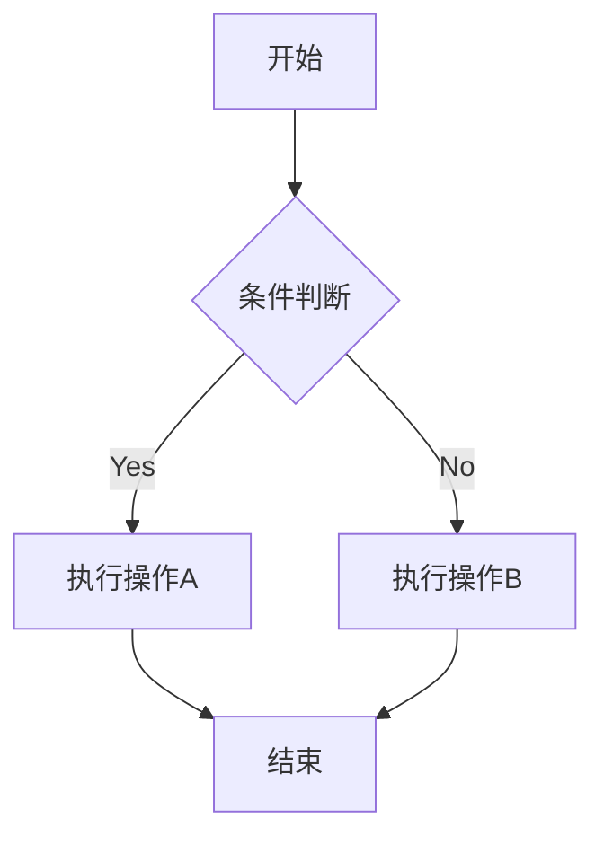
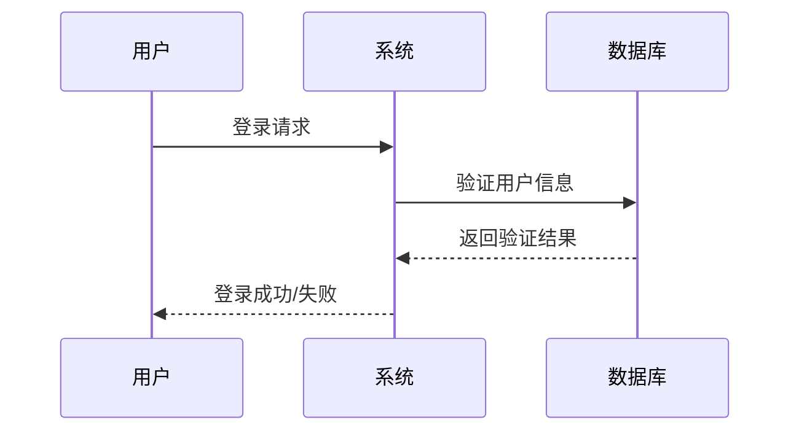
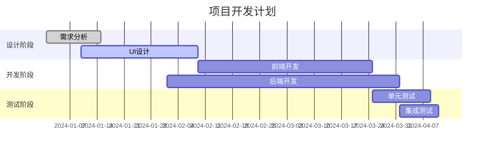
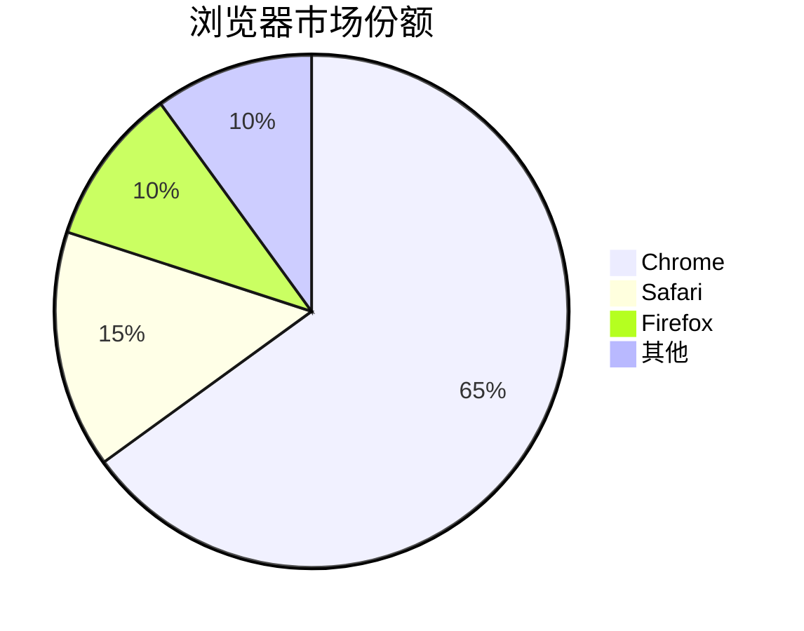
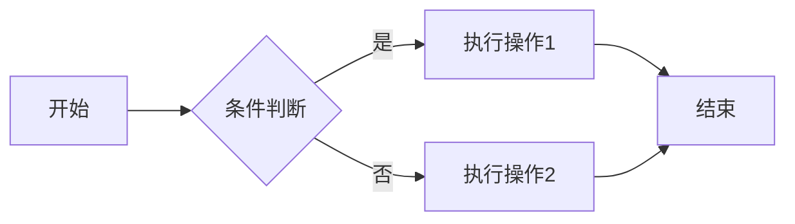
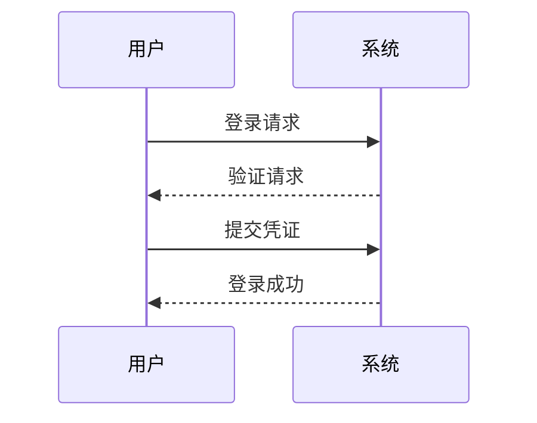
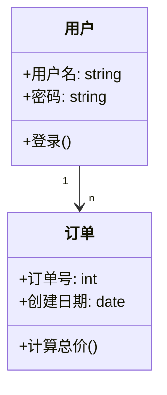
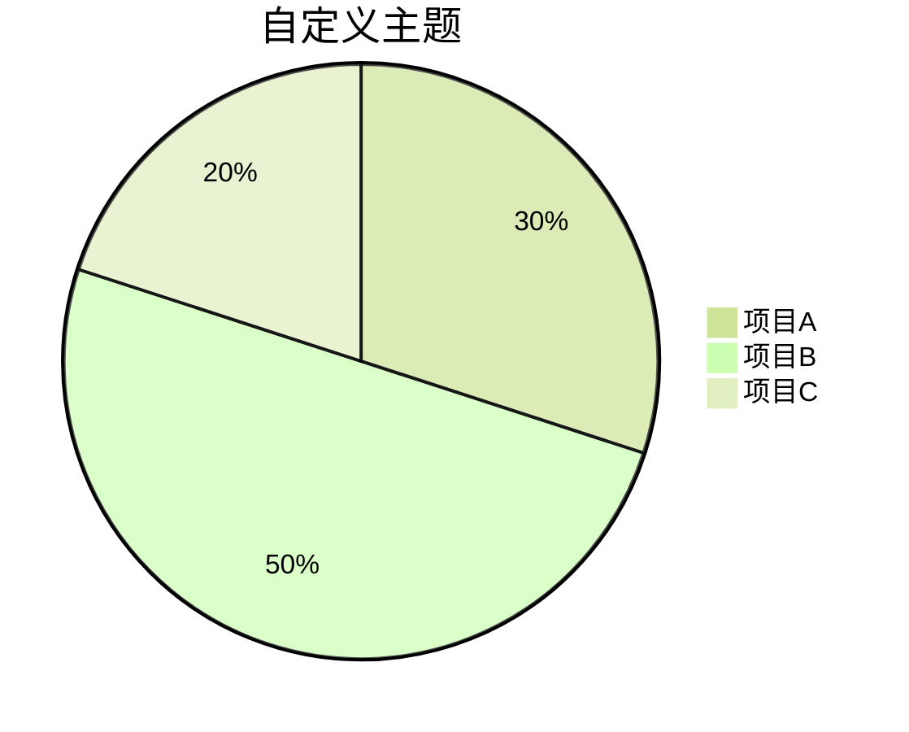
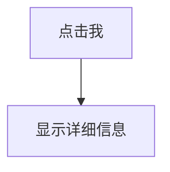

# Markdown：Markdown 图表绘制

- 来源：[Markdown 图表绘制](https://www.runoob.com/markdown/md-draw.html)
- 分类：DevOps / 工程化
- 技术：Markdown
- 笔记类型：练习笔记
- 章节序号：1823

## 本章内容

图表在技术文档中非常重要，它可以帮助我们：

- 可视化复杂的数据关系
- 展示系统架构和工作流程
- 更清晰地表达思想和概念


## 常见的 Markdown 图表工具


### Mermaid

Mermaid 是最流行的 Markdown 图表工具之一，它允许你使用简单的文本语法生成各种图表。

- 流程图 (Flowchart)
- 序列图 (Sequence Diagram)
- 类图 (Class Diagram)
- 状态图 (State Diagram)
- 甘特图 (Gantt Chart)
- 饼图 (Pie Chart)


### 流程图

```text

```

- TD 或 TB：从上到下
- BT：从下到上
- RL：从右到左
- LR：从左到右
- A[方形]：矩形
- B(圆角矩形)：圆角矩形
- C{菱形}：菱形（决策）
- D((圆形))：圆形
- E>旗帜形]：旗帜形
- --> 实线箭头
- -.-> 虚线箭头
- ==> 粗实线箭头
- -- 实线
- -. 虚线


### 时序图和甘特图

```text

```

时序图语法要点：

- participant 定义参与者
- ->> 实线箭头
- -->> 虚线箭头
- note 添加注释

```text

```

甘特图语法要点：

- title 设置标题
- dateFormat 定义日期格式
- section 定义阶段
- 任务状态：done（已完成）、active（进行中）、crit（关键）


### 饼图

```text

```


## 图表类型详解


### 流程图 (Flowchart)

流程图是最常用的图表类型，用于展示过程或算法流程。

```text

```

- graph 声明流程图
- LR 表示从左到右布局 (可选 TB/RL/BT)
- --> 表示箭头连接
- [] 表示矩形节点
- {} 表示菱形条件节点


### 序列图 (Sequence Diagram)

序列图展示对象之间的交互顺序。

```text

```

- participant 定义参与者
- ->> 表示实线箭头
- -->> 表示虚线箭头


### 类图 (Class Diagram)

类图用于面向对象设计，展示类及其关系。

```text

```


## 高级技巧


### 1. 主题定制

Mermaid 允许自定义图表样式：

```text

```


### 2. 交互式图表

一些工具支持添加交互功能：

```text

```


### 3. 导出图表

大多数工具支持将图表导出为：

- PNG 图片
- SVG 矢量图
- PDF 文档


## 工具支持情况


## 最佳实践

- 保持简洁：图表应该简单明了，避免过多细节
- 统一风格：同一文档中的图表应保持一致的风格
- 添加说明：为复杂图表添加文字说明
- 版本控制：文本格式的图表可以很好地与 Git 配合使用
- 测试渲染：在不同平台上测试图表显示效果


## 常见问题解答


### Q1: 为什么我的图表无法显示？

- 检查是否使用了正确的语法
- 确认你的 Markdown 编辑器/平台支持该图表工具
- 查看是否有语法错误


### Q2: 如何学习这些图表语法？

- 参考官方文档： Mermaid 官方文档 PlantUML 官方文档
- 使用在线编辑器实时练习


### Q3: 有没有可视化编辑器？

- Mermaid Live Editor: https://mermaid.live
- PlantUML Server: http://www.plantuml.com/plantuml


## 动手验证

- 跟着本章示例重新输入一遍，不要只复制粘贴 `Markdown 图表绘制` 的代码。
- 修改一个条件、参数或输入值，观察输出是否符合预期。
- 记录一次出错信息，并写下定位步骤和修复方式。
- 用自己的话解释示例为什么会得到当前输出。
